# Laser mode — research notes

Status: research and a headless prototype, 2026-10-25. Nothing here is
specified or scheduled; it feeds the "More specialized 2D outputs" item in
[ROADMAP.md](ROADMAP.md). Pictures of every joint are in §9. Two interactive
pages sit beside this file; open them in a browser:
[laser/connectors.html](laser/connectors.html) (the joint options by angle and
thickness) and [laser/build-modes.html](laser/build-modes.html) (the panel
rows in each mode). A clickable mockup runs in the app itself: open it with
`?sheet` in the URL (§8.5).

The idea: instead of a printable shell, the user picks a sheet **thickness**
and a **board size**. Shapemaker restricts the design to geometry that is
truly flat, outputs one 2D panel per face (with its openings), lays the
panels out on boards, and adds a way to join them: glue or tape, thread
through small holes, finger joints, or connectors (screws, clips, purpose-cut
tabs). Holes, subdivisions and in-plane fillets carry over; rounding does not.

## 1. What the code already gives us

Shapemaker is closer to this than it looks, because every design already
passes through a skeleton of flat polygons.

| Piece | Where | Use in laser mode |
|---|---|---|
| Skeleton: `positions`, planar `faces`, `edges` in mm | `src/types.js`, `src/pipeline.js` | One panel per face. Hull, jitter (plane perturbation), dual, truncate and spike all keep faces planar. |
| Face-local 2D frame | `src/faceframe.js` (`toFaceFrame`, `projectToFrame`) | Already the "into the face plane" step a panel export needs. |
| Opening generators in 2D | `OPENING_GENERATORS` in `src/solid/shell.js` (polygon inset + fillet, ellipse) | Panel cutouts come straight from these. |
| Even inner wall | `wallMode: "even"`, `cornerOffsets` in `src/solid/shell.js` | Moves every face plane in by the wall. Projected back onto its face, the inner face *is* the square-cut panel outline (see §3). |
| `macroFaceId` after subdivision | `src/subdivide.js` | Grid subdivision and Smooth 0 leave coplanar sub-faces (180° edges); these merge back into one panel. |
| Face families | `src/face-families.js` | Groups by side count today; a congruence grouping would give part counts. |
| SVG writer | `src/export/svg.js` | Camera-projected hidden-line drawing — a different job. Laser output needs its own writer. |

Not usable in laser mode: Rounding (Stage 2 dihedral rounding), Solid depth,
Sides Tapered and Cut (a laser cuts square to the sheet, which is Straight
along the face normal), Split and the print-risk overlays.

## 2. What the current shapes ask of a joint

Interior dihedral θ per design at 200 mm diameter (θ > 180° is a reflex
valley between spikes). "Inset" is the square-cut set-back `t·cot(θ/2)` at
t = 3 mm for the sharpest edge. Measured from `compile()` skeletons with a
throwaway script.

| Design | Faces | θ range | Reflex edges | Max inset @3 mm | Smallest edge | Smallest face apothem |
|---|---|---|---|---|---|---|
| tetrahedron | 4 | 70.5° | 0 | 4.24 mm | 163 mm | 47 mm |
| cube | 6 | 90° | 0 | 3.00 | 115 | 58 |
| octahedron | 8 | 109.5° | 0 | 2.12 | 141 | 41 |
| dodecahedron | 12 | 116.6° | 0 | 1.85 | 71 | 49 |
| icosahedron | 20 | 138.2° | 0 | 1.15 | 105 | 30 |
| icosidodecahedron | 32 | 142.6° | 0 | 1.01 | 62 | 18 |
| rhombicosidodecahedron | 62 | 148–159° | 0 | 0.85 | 45 | 13 |
| rhombic triacontahedron | 30 | 144° | 0 | 0.97 | 62 | 28 |
| globe | 288 | 165–178° | 0 | 0.40 | 6.8 | **2.2** |
| icosahedron, subdiv 2, Smooth 1 | 320 | 138–180° | 0 | 1.14 | 26 | 7.6 |
| icosahedron, spike 1.5 | 60 | 75–272° | 30 | 3.94 | 62 | 17 |
| stella octangula | 24 | 70–250° | 12 | 4.24 | 82 | 24 |
| great stellated dodecahedron | 60 | 63–297° | 30 | 4.85 | 44 | 14 |
| great dodecahedron | 60 | 63–243° | 60 | 4.85 | 65 | 13 |
| ring ball | 40 | 132–152° | 0 | 1.32 | **1.4** | 23 |
| ring lantern | 42 | 140–159° | 0 | 1.10 | 12 | 11 |

What this says:

- **Most shapes sit at 135–180°.** At those angles finger joints are almost
  pointless: the finger only needs to be 0.1–1 mm long, so the joint barely
  engages. Joints that work across a fold (tape, lacing, clips) suit them better.
- **Stars and spikes have both acute (63–75°) and reflex (up to 297°)
  edges.** Boxes.py and cq_warehouse both leave acute corners uncompensated
  or only partly handled. These need connectors.
- **Some details get too small.** The ring ball's dual leaves 1.4 mm edges,
  and the globe's polar faces have a 2.2 mm apothem. Minimum-size rules have
  to work on whole faces and edges, not only on opening borders.

## 3. Thickness geometry

Here the skeleton is the *outer* surface, as it is for STL, so the size the
user sets is still the outside size. Plates of thickness t lie inside it,
and lasers cut square to the sheet. Bevel heads exist only on industrial
metal machines (TRUMPF), so mitres are not an option.

- **Square-cut inset per edge: `s = t·cot(θ/2)`.** Move each panel edge in
  by s. The two inner faces then meet exactly, and the outside shows a V
  groove of width `2t·cos(θ/2)` (icosahedron at 3 mm: 2.1 mm; globe: 0.8 mm).
  The Boxes.py finger code uses the same number (`fingerLength`: `t·tan(φ/2)`,
  φ = 180° − θ, read in `boxes/edges.py`). CutCAD (RWTH, DIS 2018) sizes its
  angled fingers from the thickness and the dihedral the same way.
  - The insets differ per edge, so the panel is the face polygon with each
    edge moved by its own amount. That is the Even inner face projected onto
    the outer plane, so `shell.js` already computes it. A vertex where four
    or more faces meet needs the same corner handling `cornerOffsets` has.
- **Butt joint ("A wins").** Panel A runs to the skeleton edge and panel B
  steps back by the same s. At θ = 90° this is the ordinary box joint;
  elsewhere a wedge gap is left on one side.
- **Tab through slot.** A slanted tab crosses the receiving plate over
  `t / sin θ`. But the laser cuts the slot square to the sheet, so to let the
  tab through it must be `t/sin θ + t·|cot θ|` long, which leaves `t·|cot θ|`
  of play: 0 at 90°, 1.5 mm on a dodecahedron and 3.4 mm on an icosahedron at
  t = 3 mm. Square-cut tab and slot only suits angles near 90°. The
  connector diagrams (2026-10-25) show this. The tab must reach at least that far along its own plane. The slots
  have to lie in the tab's plane, extended past the edge. That lesson comes
  from a Glowforge thread where someone built a dodecahedron; the geometry
  checks out, but no one has test-cut it here.
- **Reflex edges (θ > 180°).** The cot term goes negative: the panel grows
  past the edge on the inside and the outside corner is open. Boxes.py
  handles concave edges with `t·sin(−φ)`.
- **Kerf.** Offset each outline by half the kerf (outer edges out, holes and
  slots in). Never change t. Kerf on a CO2 laser is about 0.1–0.3 mm. Real
  plywood thickness varies, so George Hart (Bridges 2012) gave up on friction
  fits and tied his models with twist-ties.

## 4. Ways to join panels, matched to the angle

| Method | Works for θ | Cut on the panels | Notes |
|---|---|---|---|
| Glue or tape on the inside | 90–180° | inset outline only | The simplest. Square edges touch along a line, so a glued joint needs tape or a fillet strip inside. Good for lamps and models. |
| Lacing / thread holes | 120–180° | holes along each edge, matched spacing and edge distance | Works at any obtuse angle and suits high-frequency spheres. Holes ≥ 1.5·t, at least a diameter from the edge. Zip ties fit the same holes. |
| Edge clips cut flat, in the plane across the edge | any, including acute and reflex | two short slots near each edge | The clip lies in the plane perpendicular to the edge, so its 2D outline contains the real angle θ, and one clip shape per angle class covers a whole design. Lomont's laser polyhedra and the Glowforge Polyhedra Starter Kit use this family of connector. **Best general option.** |
| Angled finger joints | about 80–150° | fingers on both mating edges | Use Boxes.py `fingerLength` and the CutCAD approach. Below about 150° the fingers are too shallow to hold anything. Closing the last panel can be hard. |
| Tab and slot | 90–160° | tabs on one edge, slots `t/sin θ` in the other | Glowforge thread above. The slot position still needs a test cut. |
| Vertex hubs, 3D-printed | any | holes or slots at each corner | A hub isn't flat, so print it from an STL Shapemaker already knows how to make. A hybrid of laser panels and printed hubs. |
| springFit cantilever tabs | 90–160° | spring tabs | From HPI (UIST 2019). Copes with kerf and thickness variation better than a press fit. A later refinement. |

Assembly labels matter as much as the joint. Every tool surveyed engraves
matching edge IDs: Pepakura (arrows), Blender Paper Model (numbers), Kyub
(plate marks and "^" for this side up), Lamina (a separate label layer).
Coded finger patterns, where only the right pairs fit, are an option for later.

## 5. Size rules

These come from vendor blogs (SendCutSend, Ponoko). Use them as defaults
that warn, not limits that block:

- holes and slots at least 1.5·t, and wider than the kerf;
- webs (opening borders) at least 0.5·t for metal; for wood use about t;
- features at least one hole diameter from an edge;
- tabs at least 2 mm after kerf;
- after the per-edge insets, the panel and its border must keep a positive
  inscribed width (the analogue of today's `PRINTABLE_BORDER_MM` in
  `src/limits.js`);
- every panel's minimum-area rectangle must fit the board.

## 6. Prior art

From the homelib library:

- **Boxes.py** (`gallery-boxes-py-ac07222b`): parametric laser boxes with
  finger and dovetail joints and flex cuts. Its experimental Platonic
  generator puts 90° fingers on every dihedral, so it is no model to copy.
  Its `fingerLength` is.
- **Box Maker** (`box-maker-57dd520e`): sizes a fold-up box from an STL;
  SVG with cut lines solid and score lines dashed.
- **Templatemaker: Platonic solids** (`the-platonic-solids-templatemaker-f8d8c954`):
  set by midsphere diameter, with glue-flap size and angle. A good reference
  for parameters.
- **Antiprism** (`antiprism-polyhedron-modelling-software-abd37fef`):
  open-source polyhedron tools, useful for checking dihedrals and nets.
- **Geodesick RGB LED spheres** (`prusaprinters-35edb50d`): printed in
  flattened strips of triangles with single-layer hinges. Unfolding into
  strips would cut down the number of joints.
- **Giant LED infinity-mirror dodecahedron** (`how-we-did-it-giant-human-sized-led-infinity-mirro-d10f2f83`):
  flat panels with steel "spider" vertex joints. The hub approach at room scale.
- **LEDodecahedron** (`davedarko-ledodecahedron-ae4320d5`): PCB faces, a
  flat-panel polyhedron made from a different sheet.
- **Onshape FeatureScript collection** (`notion-c287fd64`): has Joinery and
  Sheet Metal sections, useful if parts of this get prototyped in Onshape first.
- **Formulor** (`laser-cutting-and-engraving-for-prototypes-and-cus-18e00896`, `description-a29a5368`):
  laser service and its material specs.
- **CPL "never cut these materials"** (`https-cpl-org-...-f5f279dd`): material
  safety for the help text.

From the web (not yet in homelib):

- **CutCAD**, Heller et al., DIS 2018 — https://hci.rwth-aachen.de/publications/heller2018a.pdf.
  The closest prior art: angled finger joints from thickness and dihedral,
  shown on a truncated dodecahedron. Edges are paired by hand, there are no
  holes along edges, and the paper gives no formulas.
- **Lamina** — https://marcelfarres.github.io/lamina/. An open-source
  replacement for Slicer for Fusion 360: thickness and sheet size in; kerf,
  fit-test coupon, thin-part checks, labels, nesting, and layered SVG/DXF out.
  The scope to emulate. AGPL, so ideas only, no code.
- **Slicer for Fusion 360** (discontinued) — help PDF at
  https://adef.xyz/r/f/f1/Slicer_for_Fusion_360_Help_compressed.pdf. Folded
  panels with ten joint styles, plus slot offset for fit; no dihedral
  compensation.
- **Kyub** (CHI 2019) —
  https://hpi.de/baudisch/projects/kyub-a-3d-editor-for-modeling-sturdy-laser-cut-objects.html.
  Kerf correction, engraved plate marks, sheet layout. Rectilinear only.
- **Platener** (CHI 2015) —
  https://groups.csail.mit.edu/hcie/files/research-projects/platener/2015-chi-platener-paper.pdf.
  Picks a joint per edge and falls back to glue when the overlap is too small.
- **springFit** (UIST 2019) — https://hpi.de/baudisch/projects/springfit.html;
  **kerf-canceling mechanisms** (UIST 2020) —
  https://hpi.de/baudisch/projects/kerf-canceling-mechanisms.html.
- **George Hart**, Bridges 2012 —
  https://static1.bridgesmathart.org/2012/cdrom/proceedings/26/paper_26.pdf.
  Laser-cut plywood nodes and struts.
- **Lomont laser polyhedra** — https://lomont.org/projects/laser-poly/.
  Wedge connectors held with rubber bands.
- **Glowforge** dodecahedron tab-and-slot thread —
  https://community.glowforge.com/t/hi-its-me-again-tabs-and-slots/42544?page=2;
  Polyhedra Starter Kit — https://community.glowforge.com/t/polyhedra-starter-kit/34031.
- **SVGnest** (MIT, runs in the browser) — https://github.com/Jack000/SVGnest.
  **Deepnest** — https://github.com/jack000/deepnest. libnest2d handles
  convex polygons only, so it suits panels with holes poorly.
- **Blender Export Paper Model** —
  https://docs.blender.org/manual/en/3.6/addons/import_export/paper_model.html.
  **Pepakura** — https://tamasoft.co.jp/pepakura_designer/about-pepakura-designer.

Gaps: no source gives a tested, hub-free method for plywood at arbitrary
dihedrals. I couldn't get the full text of "Joinery" (Zheng et al., C&C 2017).
The tab-slot position formula needs a test cut.

## 7. Connectors — a closer look

### 7.1 A kit we built: Pentakis Dodecahedron (Alien Workshop Design)

This is a commercial Glowforge kit for 1/8" (3.175 mm) sheet. We measured
it to learn the method and copied none of its outlines; the licence forbids
altering or redistributing the files.

- **Parts.** 60 triangle faces, 32 vertex hubs (12 pentagons, 20 hexagons)
  and 180 struts, one per face corner. That is 272 parts for 60 faces. An
  optional front-cover triangle hides the holes.
- **Hub.** A flat plate perpendicular to the vertex axis, about 42 mm across.
  It has two 3.175 mm square slots per strut, lined up along the strut's
  radial line.
- **Strut.** About 16 × 13 mm. Two tabs at the bottom go into the hub. The
  top edge is a sloped shoulder that the face rests on, with one tab square
  to the shoulder that goes through a t × t hole in the face. The tabs carry
  small bumps of about 0.35 mm that make the press fit; glue is recommended
  as well. The slots in the file are exactly t, with no kerf compensation;
  the bumps take that up.
- **The rule:** the shoulder slope is the tilt between the face plane and
  the hub plane. The file has 20.1° at the 5-way vertices and 24.0° at the
  6-way ones; computed from the polyhedron, they are 20.08° and 23.8°.
- **Faces.** Cut full size: the skeleton is the *inner* surface and the
  sheet grows outward. At convex edges the inner corners just touch, so no
  per-edge inset is needed. The outside shows a V groove of `2t·cos(θ/2)`,
  1.3 mm at the 156.7° dihedral.
- **Hole position.** The hole is about 13 mm from the corner on the corner
  bisector, so it stays at least a sheet thickness from both edges. The
  face is held only at its corners; edges never bear on each other.
- **Closing the shell.** Every top tab is square to its own face. So the
  last face drops straight on along its normal onto all its struts at once,
  which avoids the problem several builders report with channel or edge-bar
  systems (assemble loosely, tighten last).

Also in that folder: `unfolded-icosidodecahedron-46mm.svg` is a one-piece
net with scored folds. That is the card or fold-hinge route, a different
method.

### 7.2 The general principle: connectors cut in a plane square to the faces

A flat connector reproduces an angle exactly when its own plane is
perpendicular to the faces it holds. The angle is then just a line in its 2D
outline, and its tabs pass straight through rectangular t-wide holes.
Two layouts follow from this:

| | Vertex hub + struts | Edge clip |
|---|---|---|
| Connector plane | contains the hub axis `a` and the face normal `n` | perpendicular to the edge |
| Angle in the outline | shoulder slope `α = ∠(n, a)` | the dihedral θ between the two shoulders |
| Always square to the face? | only where the plane `span(a, n)` passes through the face corner | **always**: both faces contain the edge direction |
| Hole in the face | t × w on the line from the corner along the projected axis (the bisector on canonical solids), about h from the corner | t (along the edge) × w (across it), about h from the edge |
| Parts for 60 faces (pentakis) | 32 hubs + 180 struts | 90 clips (180 for two per edge) |
| Distinct shapes | one strut per (degree, tilt) class | one clip per dihedral class |
| Reflex / valley | fails (see below) | works: the clip has a reflex angle and sits in the valley |

For the hub axis, the mean of the face normals works. On canonical solids
it equals the radial direction.

### 7.3 Do hubs work on Shapemaker's shapes?

For each vertex: the axis is the mean of the face normals; for each corner,
the tilt, how far the strut's line in the face strays from the corner
bisector, and whether it still enters the face at all. Measured at 200 mm
with a throwaway script.

| Design | Hubs | Struts | Tilt | Off bisector (max) | Corners missed | Strut classes |
|---|---|---|---|---|---|---|
| Platonic solids | 4–20 | 12–60 | 37–71° | 0° | 0 | 1 |
| icosidodecahedron | 30 | 120 | 21–32° | 0° | 0 | 1 |
| rhombicosidodecahedron | 60 | 240 | 15–23° | 0.7° | 0 | 1 |
| rhombic triacontahedron | 32 | 120 | 21–32° | 0° | 0 | 2 |
| globe | 266 | 1104 | 8–11° | 34° | 0 | 7 |
| twisted globe | 266 | 1584 | 6–9° | 35° | 0 | 7 |
| icosahedron, jitter 0.3 | 36 | 108 | 15–46° | 8.5° | 0 | 5 |
| ring lantern | 80 | 240 | 16–25° | 12° | 0 | 4 |
| ring ball | 76 | 228 | 13–30° | 8° | 0 | 35 |
| fibonacci sphere | 24 | 132 | 22–36° | 29° | 8 | 12 |
| random hull | 24 | 132 | 15–49° | 56° | 32 | 24 |
| stars and spiked shapes | 14–32 | 72–180 | 37–79° | up to 90° | **all valley corners** (48–120) | 2 |

Findings:

- **Convex, near-canonical shapes:** hubs are exact. The strut sits on the
  bisector and there are only one or two strut shapes. These are the shapes
  the kit method was made for.
- **Globes and jittered shapes:** hubs still work, but the hole must be
  placed along the projected axis, up to 35° off the bisector, so that the
  strut stays square to the face. A generated design handles that easily.
  The part count is the real problem: the globe needs 266 hubs and 1,104
  struts.
- **Random hulls and fibonacci spheres:** a few corners are missed. A
  better hub axis per vertex might fix them; this hasn't been tried.
- **Stars and spikes:** the tips work, but at every valley vertex the strut
  plane misses the face. Use edge clips there, or for the whole design.
- **Coplanar sub-faces** after subdivision must merge before any of this
  runs. Otherwise the 180° "corners" count as misses.

### 7.4 Other connector families (web survey)

- **Edge bars and vertex nodes** (Glowforge community, "Some geometry with
  big names"): separate edge pieces carry the angle, with triangle and
  pentagon nodes at the vertices, held by tab and slot without glue. On
  3 mm Baltic birch the slots were 2.9 mm, tapering to 2.85 mm. The builder
  had to assemble loosely first.
  https://community.glowforge.com/t/some-geometry-with-big-names/45732
- **Separate acute and obtuse connectors** (Harvard, MIT fab class 2017):
  the angle is built into each connector type. Changing the obtuse connector
  gives a different stellation.
  https://fab.cba.mit.edu/classes/863.17/Harvard/people/julia-ebert/2017/09/13/computer-controlled-cutting.html
- **Cable ties through edge holes** (George Hart, Bridges 2015): the tie is
  a hinge, so it works at any angle. Holes go at the edge midpoints, or at
  1/4 and 3/4 on long edges. Rigidity comes from bevels (sanded) or glue.
  Without bevels the gap grows with the angle: fine at 150–178°, poor for
  spikes. https://archive.bridgesmathart.org/2015/bridges2015-77.html
- **Slide-together slit cards** (Hart): planes pass through each other along
  slits, and the slit positions come from the plane intersections. The width
  for a crossing at angle α is about t/sin α; this is my derivation, not
  confirmed. Key paper to read: Bridges 2008 "Edge-based intersected
  polyhedral paper sculptures", https://archive.bridgesmathart.org/2008/bridges2008-259.html.
- **Fixed-angle bearing connectors** (patent US 9926697): extruded or
  printed angle pieces that panels are fastened onto. Needs one part per
  angle, or a printed part.
- **T-slot captive nuts:** strong, but at non-90° angles they need a bevel
  or a printed wedge. None of the sources solves this.
- **Print&Fold** (UIST 2026, arXiv 2608.13279): a printed net with hinges
  and chamfer stops. The chamfer-as-stop idea could carry over to a taped
  laser net.

Fit details that recur: bumps or nubs on tabs (the kit, Ponoko), slightly
tapered slots, corner radii of at least 0.5 mm in acrylic, and a fit-test
coupon per sheet of plywood.

### 7.5 What this suggests

- Make **edge clips** the general connector. They are square to the faces
  for every edge, including acute and reflex ones, and need fewer parts than
  hubs (one or two per edge). Each face still drops on along its normal.
- Offer **vertex hubs** for convex, near-canonical shapes. They give the kit
  look, with one or two strut shapes and rigid nodes, and suit lamps because
  the inside stays open.
- Offer **tie or lace holes** for high-frequency spheres, where clips or
  hubs would run to more than 1,000 parts.
- Use the inner-surface convention for convex edges, so the skeleton face
  is the panel and needs no inset. Reflex edges need the `t·cot` inset
  instead (§3).
- The shared parameters are t, kerf, tab width w, tab bump size, hole
  distance h from the edge or corner, and the minimum web.

## 8. Plan: Cut and Fold modes (2026-10-25)

The user's direction: the most interesting joints for solid sheet are
**edge clips, zip ties and tabs**. Thin stock (paper, card, felt) folds
instead. There, fold lines are a layer of their own next to the cut lines,
and the edges that stay open get tape or stitching. The interface has to
add this without making the panel harder to take in.

### 8.1 Interface: one switch, the rest adapts

- **One new control: Build = Print · Cut · Fold**, the first row of Form.
  Start and Shape don't change, so every shape works in every mode.
  Switching modes keeps each mode's own settings.
- **Cut mode (rigid sheet):**
  - Sheet thickness takes Wall's place.
  - Join: Clips · Ties · Tabs. One choice per design; edges a join can't
    serve (tabs away from 90°, ties on sharp edges) fall back to clips and
    are counted in the status line.
  - Openings stay. Kerf and fit go under Advanced.
  - Make holds the Board (presets plus custom) and edge labels.
  - Hidden: Shell, Wall, Rounding, Sides, Inner wall, Break out, Quality
    and Mass.
- **Fold mode (thin stock):**
  - Join: Tape · Flaps · Sew.
  - Fold lines: Score · Perforate · Mark.
  - Openings stay. Make holds the Board.
  - Clicking a face picks the centre of the net, which reuses today's
    resting-face click.
- **Viewport:**
  - A **Flat** toggle joins Section. It switches between the 3D model and
    the boards or nets laid out. Clicking a panel highlights it on the model.
  - Print risk and Split hide outside Print.
- **Bottom bar:** in Cut and Fold, Export STL becomes **Export cut file**
  (layered SVG). Export SVG (the line drawing) stays.
- **Status line:** parts, boards and the smallest web or panel. Warnings
  use the same "fix" pattern the print warnings use.
- **Project file:** new keys (`build`, `sheetMm`, `join`, `foldStyle`,
  `board`, `kerfMm`) with defaults, so old links and files open unchanged.

### 8.2 The cut file

- It is one SVG in millimetres, with one colour per operation:
  - cut: red
  - score or fold: blue, dashed for mountain folds and dot-dash for valley
  - engrave or labels: grey
- The user's own icosidodecahedron net already uses blue for folds. The
  Pentakis kit uses separate colours for cut and score.
- Each board is its own group, plus a fit-test coupon (Cut mode).

### 8.3 Shared engine, two strategies

`src/sheet/` (new) takes the skeleton and the Build settings. It returns
panels as 2D outlines with holes, an edge table (which panels, angle, join)
and the boards. The work divides like this:

| Step | Cut | Fold |
|---|---|---|
| Panels | one per face (coplanar faces merged), inner-surface convention, reflex edges inset | faces grouped into nets by unfolding |
| Edges inside a net | — | fold lines (mountain or valley from the angle sign) |
| Edges between parts | clips, tie holes or tabs | tape, glue flaps or sewing holes |
| Openings | the existing 2D generators | same |
| Checks | web ≥ t, hole ≥ 1.5·t, panel fits the board | flap fits, nets don't overlap, net fits the board |
| Layout | shelf packing of min-area rectangles | one net per board where possible, otherwise split |

Unfolding is the only new algorithm with real risk. A spanning tree over
the faces can overlap itself; when it does, split it into more nets. High
face counts (globes) will need several nets.

### 8.4 Phases

0. **Headless prototype and test cuts (no UI).** A node script writes cut
   files for:
   - an icosidodecahedron in 3 mm ply with clips and tie holes, plus a fit
     coupon;
   - an icosahedron net on card with score lines and glue flaps.

   The user cuts them; the gate is whether the parts fit and close.

   **Status (2026-10-25):** built as `src/sheet/` (panels, cut, fold,
   layout, svg, font) and `scripts/sheet-samples.mjs`, which writes 16
   designs as Falcon A1 boards with a fit coupon (test/sheet.test.js covers
   the invariants). Not wired into the UI. Not yet test-cut. Things the
   samples already show:
   - Clips need a wider Border than printing does: icosidodecahedron 36% →
     59% at 3 mm. The script raises it and says so.
   - The globe unfolds into spidery nets. Gores (meridian strips) would suit
     it better.
   - Labels skip faces that are too small.
1. **Cut mode:**
   - the Build switch;
   - Sheet and Join (Clips, Ties) controls;
   - Board and labels;
   - the Flat view, cut-file export and status warnings.
2. **Fold mode:** nets, the fold-line layer, tape, flaps and sewing holes,
   and the net-centre click.
3. **Tabs:** near-90° edges only, falling back to clips elsewhere.
4. **Later:** vertex hubs, DXF, SVGnest nesting and kerf calibration.

The board's "Define specialized 2D output workflow" story
(card_0d8fe8fb) is largely answered by this file.

### 8.5 Clickable mockup in the app (2026-10-28)

Adding `?sheet` to the app's URL (`http://localhost:8000/?sheet`) mounts
`src/sheet/mockup.js` over the real panel. Without the flag the app is
unchanged. It is a mockup of the interface in §8.1, built on the real
engine:

- **Build** (Print · Cut · Fold) is the first row of Form. Each mode keeps its
  own settings (stored in the browser, not in the design or the URL).
- **Cut:** Sheet and Join (Clips · Ties · Tabs) replace Shell, Wall and
  Rounding. Advanced holds Kerf and Fit; Sides and the print Advanced rows
  hide. Make shows Board (the profiles plus Custom) and Labels in place of
  Quality, Material and Mass.
- **Fold:** Join (Tape · Flaps · Sew) and Fold lines (Score · Perforate ·
  Mark). Clicking a face centres the first net on it.
- **Viewer:** the parts put together (plates, clips, ties, tabs; paper,
  flaps, tape, stitches) stand in for the printed shell, rebuilt on every
  edit. Print risk, Split and Section hide.
- **Flat** joins the viewport toggles. It shows the boards with the cut-file
  colours on a plywood or paper ground, one tab per board. Hovering a part
  names it; clicking a panel, clip or net goes back to 3D and lights it up.
- **Bottom bar:** Export cut file downloads one layered SVG per board, and
  the status line reports parts, joins and boards. Its first warning uses
  the app's fix pattern (for clip slots: a wider Border, or closed faces).

What it doesn't do yet: the Section plane doesn't clip the plates, Fold's
net-centre click also turns the model onto that face (it reuses the
resting-face pick), nothing is saved with the design, and every edit
rebuilds the sheet, which is slow on dense shapes.

| | |
|---|---|
| 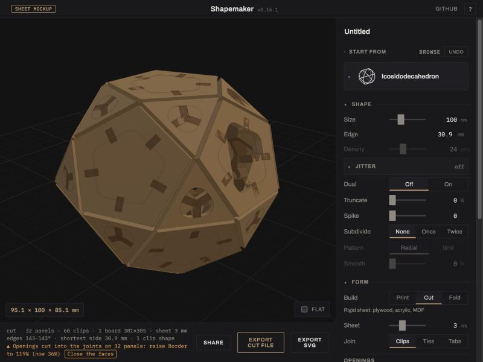 | 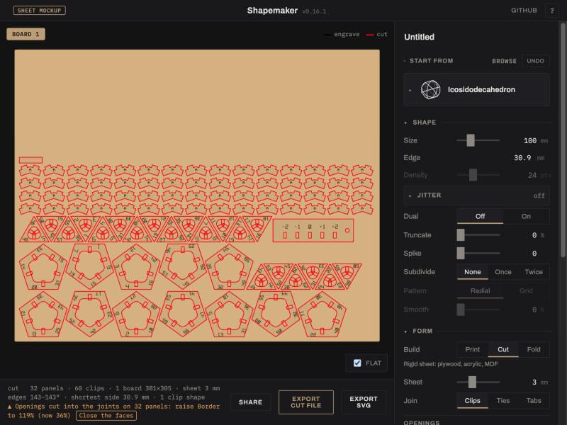 |
| Cut, Clips: the plates and clips in the viewer, the Build switch in Form, a fix on the status line. | Flat: the Falcon A1 board with panels, clips and the fit strip. |
| 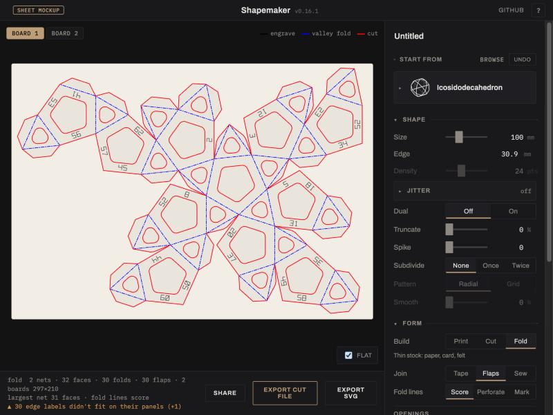 | 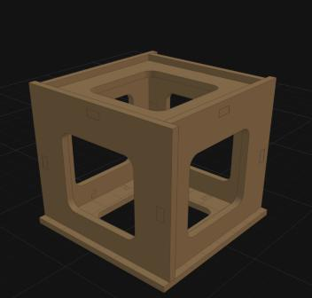 |
| Fold, Flaps: the A4 net with valley folds and glue flaps. | Cut, Tabs on a cube. |

## 9. Pictures

These are rendered by `scripts/sheet-samples.mjs` (with `scripts/lib/render3d.mjs`)
from the same cut outlines that go to the laser: panels are the real cut
parts extruded by the sheet thickness, and clips, ties, flaps, tape and
stitches sit where the cut file puts their slots and holes. The cutaways drop
the near half of the model to show the joints inside. Running the script
writes the full set, with every board, to `test/out/sheet/index.html`.

### Cut mode (rigid sheet)

| | |
|---|---|
| 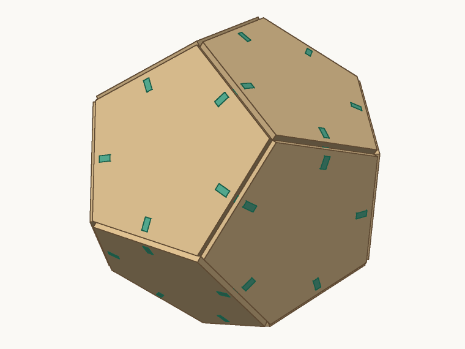 | 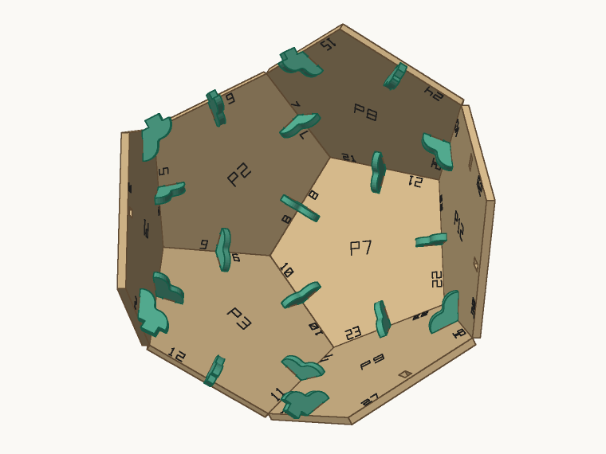 |
| Dodecahedron, assembled. The clip tabs show flush on the outside. | Cutaway: every edge has one clip on the inside, numbered panels. |
| 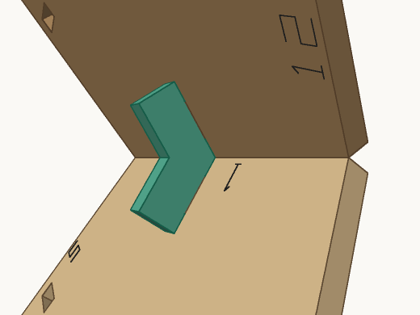 | 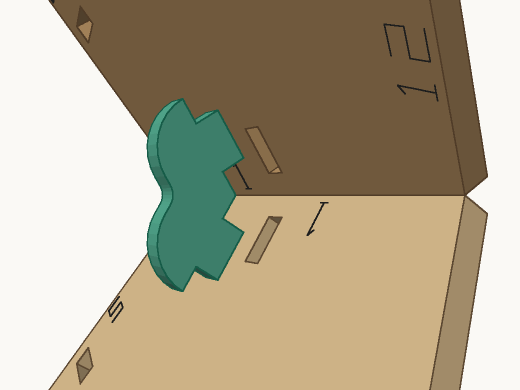 |
| The clip lies in the plane square to the edge, so its outline holds the 116.6° angle exactly. | Pulled out of its slots: one tab per panel. |
| 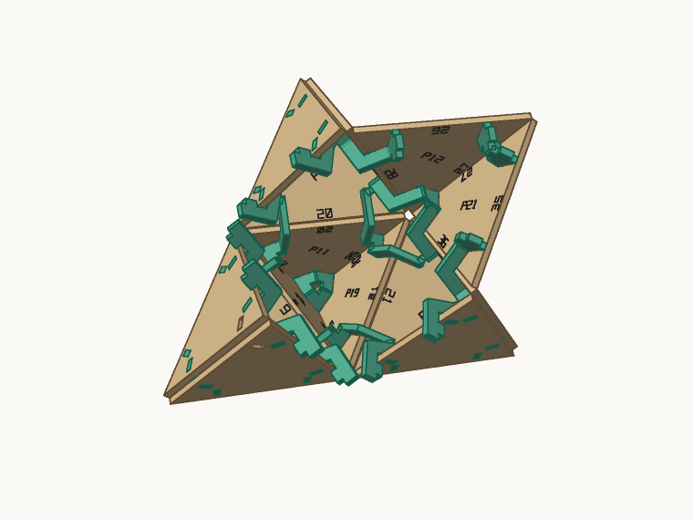 | 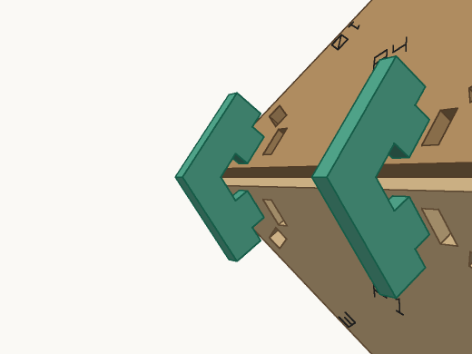 |
| Stella octangula: tip edges and valley edges each get their own clip class. | A valley clip (250.5°) sits in the valley between two points. |
| 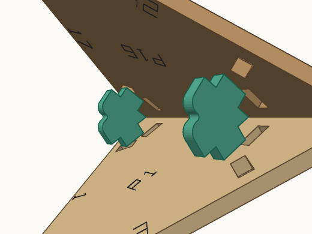 | 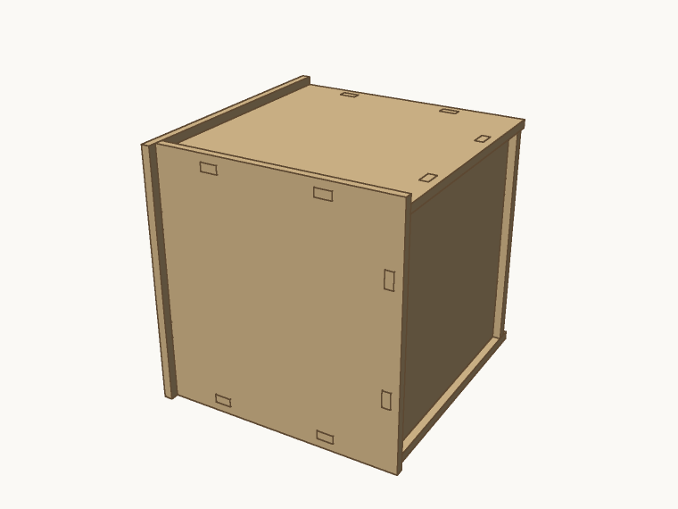 |
| A tip clip (70.5°) at a sharp edge. | Cube with tab-and-slot joints: tabs only near 90° (§3). |
| 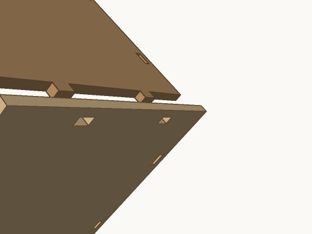 | 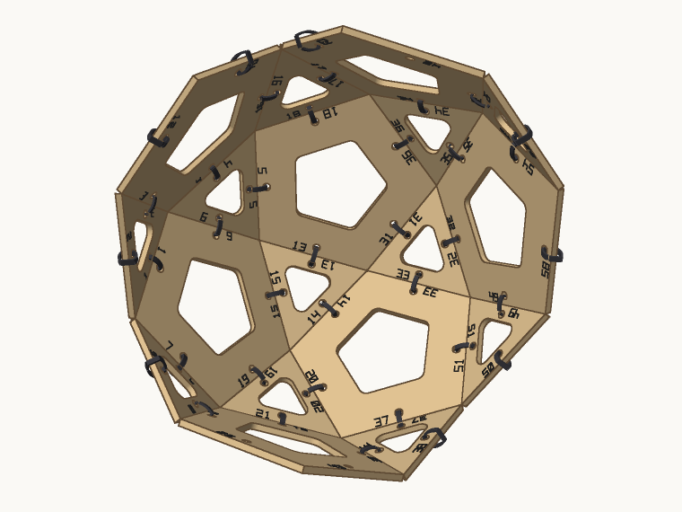 |
| One panel drawn back: its tabs, and the slots in the other panel's lip. | Icosidodecahedron held by zip ties, with openings. |
| 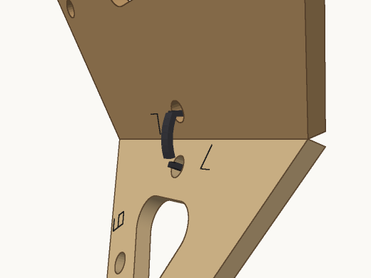 | |
| A tie through a hole in each panel, looped over the edge. | |

### Fold mode (paper, card, felt)

| | |
|---|---|
| 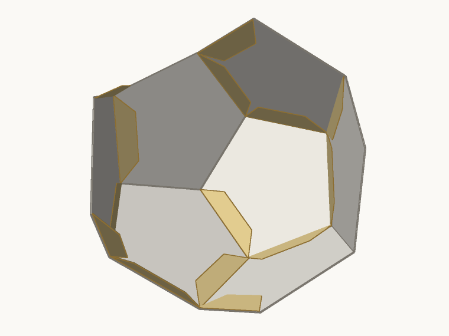 | 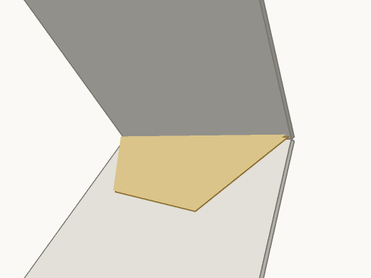 |
| Paper dodecahedron: one net, glue flaps folded under the neighbours. | A flap hangs off one face and is glued under the next. |
| 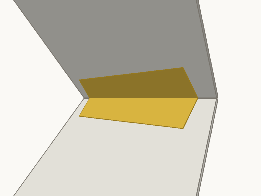 | 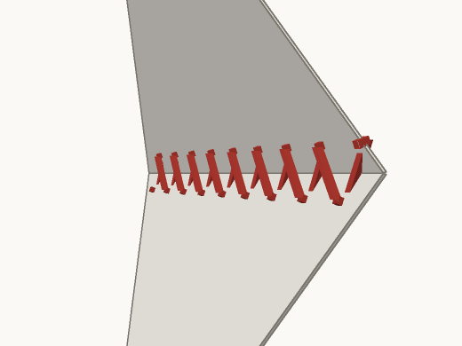 |
| Tape across the inside of an open edge. | Felt: whip stitches through matching holes. |
| 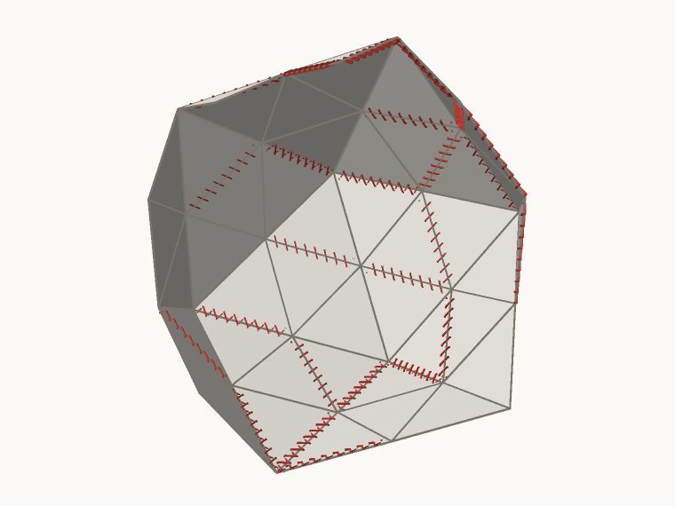 | |
| An 80-face geodesic in felt, stitched along its open edges. | |

### Boards

| Plywood test (310 × 170 mm, 2 mm) | Paper test (A4) | Spiked net, mountain and valley folds |
|---|---|---|
| 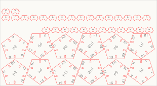 | 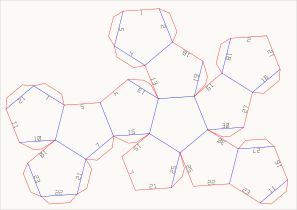 | 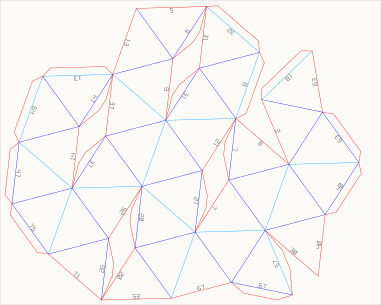 |

Red is cut, black is engraved (edge numbers, on the model's inside), blue is
a valley fold and light blue a mountain fold as seen on the sheet. The board
outlines appear only in these previews.

## Open questions

- Machine and materials: which laser and bed size, and which sheet for the
  first test cut?
- Felt has no score line. Should Fold on felt draw no fold lines, or mark
  them lightly for sewing guides?
- Labels: engraved numbers on the inside face of every edge pair, or only
  part numbers?
