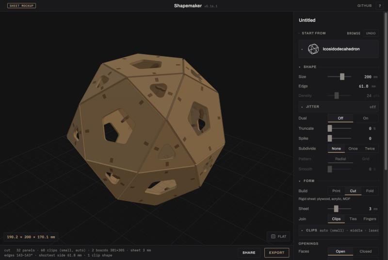
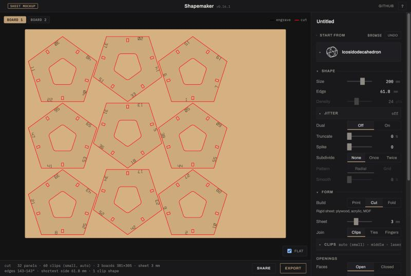
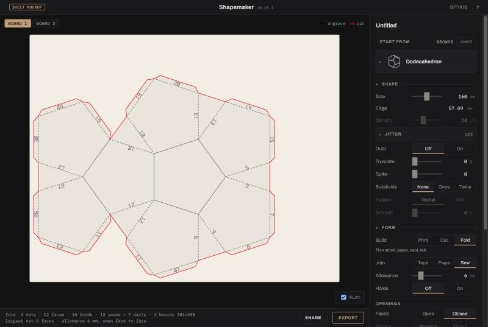
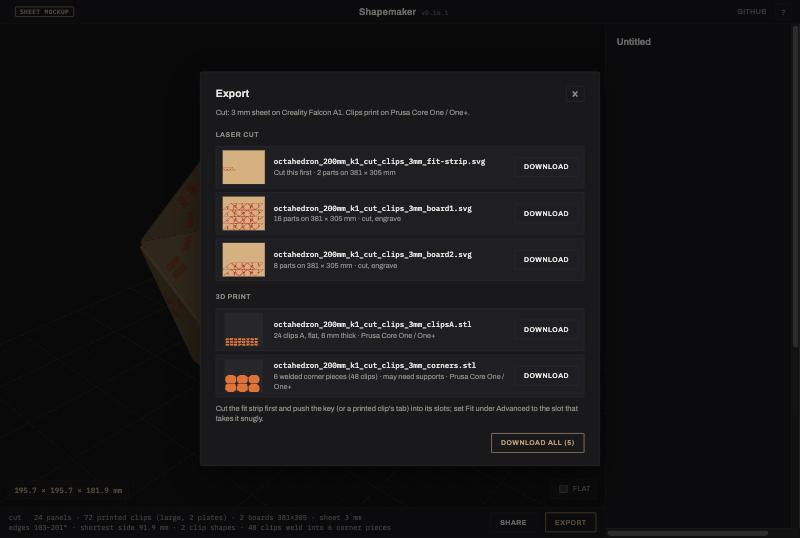

# Production: from a shape to the files that make it

Status: design for the first release with new outputs, written 2026-10-31.
[SPEC.md](SPEC.md) stays binding for what ships today. This file holds the
architecture, which is built, and the decisions for that release, which are
not shipped yet: Cut and Fold still run only behind `?sheet`. When they ship,
§4 moves into the spec.

The research behind it is in
[research/sheet-output.md](research/sheet-output.md). Designs that build today
are in [examples/](examples/).

## 1. The split

A design has two halves, and each stage reads only its own:

| | What it says | Where it lives | Read by |
|---|---|---|---|
| **State** | What the thing is | `state` in a project, the URL hash | `compile()`, `compileShape()` |
| **Job** | How it gets made | `production` in a project | `produce()` |

```text
                  ┌ compileShape(state) ─ skeleton ──────────┐
 state ───────────┤                                          ├─ produce(shape, job)
                  └ compile(state) ─── skeleton + shell ─────┘        │
                     Print needs the shell;                  finishProduction(prod)
                     Cut and Fold never do                            │
                                                   ┌──────────────────┼───────────────┐
                                             listArtifacts()     summarize()     sheetViews()
                                                files              words          pictures
```

State keys fall into three groups, which `PRINT_KEYS` in `src/schema.js`
draws:

| Group | Keys | Used by |
|---|---|---|
| Shape | base, size, points, seed, separation, jitter, dual, truncate, spike, subdivide, soften, resting face | every process |
| Openings | openings, style, border, fillet | every process |
| Printed shell | depth, wall, wall mode, sides, break out, rounding, quality | Print only |

So a Wall that would fail a print can't fail a laser job, and dragging a
slider in Cut needn't solidify a shell. The CLI works this way today; the app
gets there in step 2 of §5.

### Layers

Each layer may use the ones above it, never the ones below.

| Layer | Code | Does | Must not |
|---|---|---|---|
| Shape | `compile.js`, `pipeline.js`, `points/`, `dual.js`, … | State to skeleton, and the printed shell | Know about production |
| Sheet engine | `src/sheet/` | Skeleton and options to parts, boards and plates | Know about jobs, files or the DOM |
| Production | `src/production/` | Job to finished production, file list, status words | Touch the DOM, a file system or a viewer |
| Adapters | Web: `main.js`, `sheet-mockup.js`, `flat-view.js`, `viewer.js`. CLI: `scripts/shapemaker.mjs` | Input, display, download or write | Compute geometry, or decide what files exist |

`test/production.test.js` enforces these import rules, including that the
adapters reach the engine only through `src/production/`, and that the CLI
writes the same bytes as the library.

### Jobs

A job is plain JSON. `JOB_DEFS` in `src/production/job.js` is the one table of
its settings: default, bounds, label, hint, panel group, and when each
applies. The panel builds its rows from it, the CLI its flags, and
`normalizeJob` checks saved jobs against it, and settings pass straight to the
engine, so a new setting is one row in that table.

```json
{
  "process": "fold",
  "fold": { "join": "sew", "seamMm": 8, "board": "falcon-a1", "…": "…" }
}
```

A saved job writes the process in use out in full, as `state` does, so a later
change of default can't change an existing design; the other processes keep
only what differs from their defaults. Each process keeps its own settings
while another is in use, so switching Build and back loses nothing. An old or
hand-edited job falls back setting by setting; it never fails to open.

### The same workflow, either way

| Step | Web | CLI |
|---|---|---|
| Describe the shape | Panel, link or project file | Project file and/or flags |
| Describe the job | Build and its rows | Project's `production`, and/or flags |
| See what you'd get | Status line, 3D, Flat | `plan` (`--json` for scripts) |
| Accept a fix | The button on the warning | `--fix` |
| Get the files | Export dialog | `build`, plus `manifest.json` |
| Keep the design | Save project | `--save=FILE` |

```bash
node scripts/shapemaker.mjs plan docs/examples/cut-dodecahedron-clips.shapemaker.json
```

```bash
node scripts/shapemaker.mjs build --base=cube --diameter=140 --openings=false --process=cut --join=fingers --out=out/cube
```

```bash
node scripts/shapemaker.mjs settings --process=fold
```

Both read `listArtifacts()`, so the dialog and the CLI can't disagree about
what a design makes or what the files are called. A new output is one entry in
that list and appears in both.

### Adding a process

1. Add its settings to `JOB_DEFS`, its id to `PROCESSES`, and its words to
   `PROCESS_STOCK`.
2. Give `produce()` a branch that returns its result on the production.
3. Add its files to `listArtifacts()` and its lines to `summarize()`.
4. If it draws flat layouts, return them from `sheetViews()`.

The Build switch, CLI, Export dialog and project format then follow. The panel
builds its rows from the table; only a new panel group needs a place of its own.

## 2. What the mockup showed

Reviewing `?sheet` on the real app, 2026-10-31.



| | |
|---|---|
|  |  |
| Flat: the first board of an icosidodecahedron, one tab per board. | Fold, Sew: seam allowances, darts and the stitch line. |



The structure holds up: one switch, rows that swap, Flat beside 3D, one Export
dialog. Changed during this review:

- **The fit strip is its own file, cut first.** It keeps its place in the
  layout, and the model files leave that spot empty, so the sheet stays put
  between the two runs. Only the headless test cuts did this before.
- **Fit reads like the fit strip.** The strip's slots are marked −2 to +2,
  in tenths of a millimetre, but Fit offered Snug, Normal and Loose, so a
  reading couldn't be entered. Fit now offers those five numbers. +1 is the
  old Normal, and the default.
- **Sew always marks its fold lines.** Felt can't be scored, so the row is
  gone for Sew.
- **Score gets a test strip**, since scoring power depends on the machine and
  the stock.
- **Download all is staggered.** It clicked every file in one tick, which
  browsers coalesce or block.

Still wrong, and fixed by the release (§5):

- **Cut's first impression is a dead end.** Choosing Cut on the default 100 mm
  icosidodecahedron closes all 32 faces and offers no fix, because no Border
  clears a 3 mm clip's arm at that size. The warning needs a way out.
- **Two things are called Cut.** Build has Cut, and Print's Sides row has
  Tapered, Straight and Cut.
- **Fold's face click also turns the model**, because it reuses the
  resting-face pick. Only the net should change.
- **The app still goes through the shell in Cut and Fold**, because it calls
  `compile()` in every mode. Every edit builds a shell, and a design only a
  print would refuse is refused here too, with the error on a row Cut hides.
- **Job edits don't mark the project modified** yet.
- **Nothing is in a link yet**, so sharing a Cut design shares only its shape.

## 3. Decisions for the first release

**Locked** is settled, whether or not it's built yet; §2 and §5 say what's
left. **Proposed** is a recommendation waiting for a yes, because it drops
something or changes a shipped label.

### What it makes

| # | Decision | Status |
|---|---|---|
| 1 | Three processes on one **Build** switch, first row of Form: Print, Cut, Fold. Print is the default, so every existing link and project opens as it does now. | Locked |
| 2 | Every shape works in every process. Start and Shape don't change. | Locked |
| 3 | Cut joins: Clips, Ties, Fingers. One choice per design; edges it can't serve fall back and the status line counts them. | Locked |
| 4 | Clip options stay, collapsed: Size (Auto, S, M, L), Per edge, Place. | Locked |
| 5 | Printed clips ship in the first release, with Width and Print bed. | Proposed: yes. Hybrid laser and print is the distinctive output, and the plates are checked as closed solids. |
| 6 | Weld ships with the default **off**, until a printed corner piece has been tried. The code has it on today. | Proposed: flip it. The pieces may need supports, and none has been printed. |
| 7 | Fold joins: Tape, Flaps, Sew. Sew has Allowance and Holes. | Locked |
| 8 | One openings rule everywhere: a joint's footprint closes the whole face, never part of it, and the status line offers the Border that opens it. | Locked |
| 9 | No material library. Sheet thickness, kerf and Fit are the whole model. No laser power or speed. | Locked |

### The panel

| # | Decision | Status |
|---|---|---|
| 10 | Cut and Fold hide Shell, Wall, Rounding, Sides, the print Advanced rows, Quality, and Material and Mass. | Locked |
| 11 | Board is in Make: machine profiles, sheet sizes and Custom. Cut defaults to the Falcon A1, Fold to A4. Each process keeps its own. | Locked |
| 12 | Labels: edge numbers on the inside of each pair, with a Labels switch; numbers go on the seam allowance when sewn. | Locked |
| 13 | The word in the UI is **Build**; the word in code and files is `process`. | Locked |
| 14 | Print's Sides option **Cut** is renamed **Through**. Its stored value is already `through`, so no file changes. | Proposed: yes. |

### The viewer

| # | Decision | Status |
|---|---|---|
| 15 | 3D shows the real parts assembled. **Flat** joins the viewport toggles; clicking a part goes back to 3D and lights it up. | Locked |
| 16 | Print risk, Section and Split hide in Cut and Fold. Section can't cut through plates yet. | Locked |
| 17 | Clicking a face in Fold centres the net, and doesn't turn the model. | Locked |

### Files

| # | Decision | Status |
|---|---|---|
| 18 | One Export button and dialog in every process, replacing Export STL and Export SVG. Print goes through `listArtifacts()` too. | Locked |
| 19 | Sheet files are SVG in millimetres, one per board, one colour per operation: red cut, blue valley, light blue mountain, black engrave. No DXF. | Locked |
| 20 | Files are named `<stem>_<process>_<join>[_<sheet>mm][_boardN \| _fit-strip \| _fold-strip \| _clipsA \| _corners]`. | Locked |
| 21 | Download all makes one `.zip`, from a small store-only writer with no dependency. Stagger stays as the fallback. | Proposed: yes. A five-file job otherwise trips the browser's multiple-downloads prompt. |

### Saving

| # | Decision | Status |
|---|---|---|
| 22 | A project's job is an optional `production` block, kept even by a session that doesn't use it, across Undo too. `formatVersion` stays 1: the block never changes the shape, and older apps ignore it. A project without one opens in Print. | Locked, built |
| 23 | Links carry the job as a second segment after the state, and only when it isn't Print. Today's links stay valid. | Locked |
| 24 | Each process's last settings stay in the browser as a convenience only, like the panel's open groups. | Locked |

## 4. Acceptance for the release

Written to move into the spec:

- Every shape and preset in the start chooser builds in Cut and Fold, or says
  why not in a warning that offers a way forward.
- A design built in the app and by the CLI gives byte-identical cut files.
- Without a job, a project or link behaves exactly as it does today.
- A project saved in Cut reopens in Cut, with the same files; so does its link.
- Changing a Cut or Fold setting never rebuilds a shell, and most shapes lay
  out within 0.3 s (1.4 s for a globe).
- Every warning names what to change. A fix, when offered, works.
- Plates pass the mesh check as closed solids, one body per clip.

## 5. Order of work

1. **Test cuts first.** These need hands, and they're the gate on everything
   below: nothing here has been cut, folded or sewn. The files are in
   [examples/test-cuts/](examples/test-cuts/).
   - Paper dodecahedron on A4: does the score strip fold, and does the net
     close?
   - 2 mm plywood, clips: does the fit strip give a reading, and does it hold?
   - 2 mm plywood, fingers.
   - A felt seam sample, and one printed clip in the fit strip.
2. **Ship the panel.** Move the Build switch and rows into `ui.js`, the styles
   into `index.html`, and drop `?sheet`. Have `main.js` call `compileShape()`
   in Cut and Fold, take Print's export from `listArtifacts()`, and count job
   edits as changes to the project. Fix the Fold click and rename Sides.
3. **Give closed faces a way out.** When no Border opens them, offer the size
   that does, found the same way the Border fix is.
4. **Links and the zip** (§3, 21 and 23).
5. **Promote.** Move §1 and §4 into the spec, cut the release, and update the
   README and changelog.

## 6. Later

Not in the first release:

- Vertex hubs as a fourth Cut join.
- DXF, and true nesting (SVGnest) in place of shelf packing.
- Kerf calibration beyond the fit strip.
- Gores for globes; their nets are spidery, and their last 3 edges still
  fall back to whip stitches.
- A printed assembly sheet: which part goes where.
- Section through the assembled plates.
- Material presets, if a real workflow asks for them.
