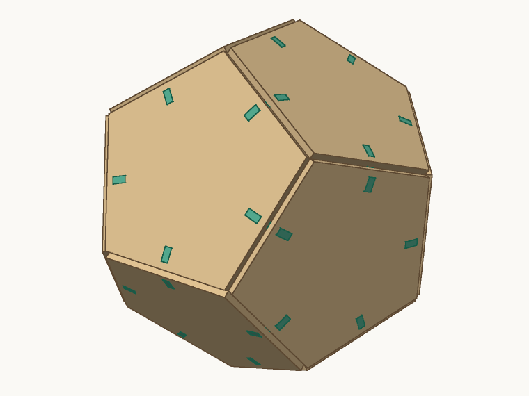
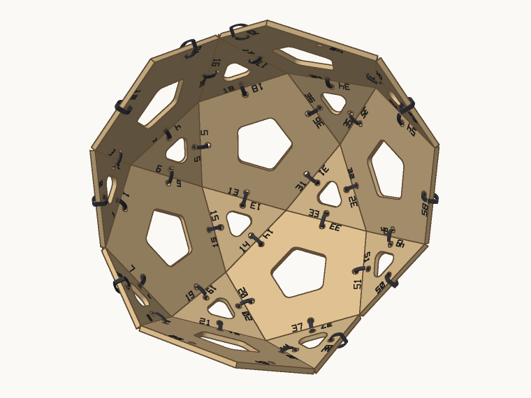
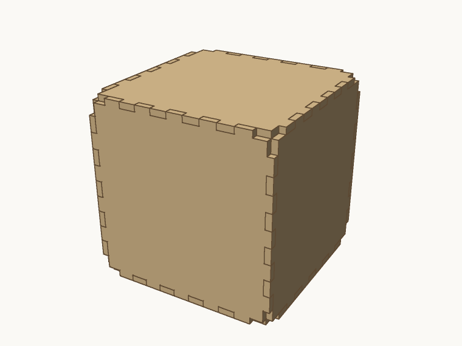
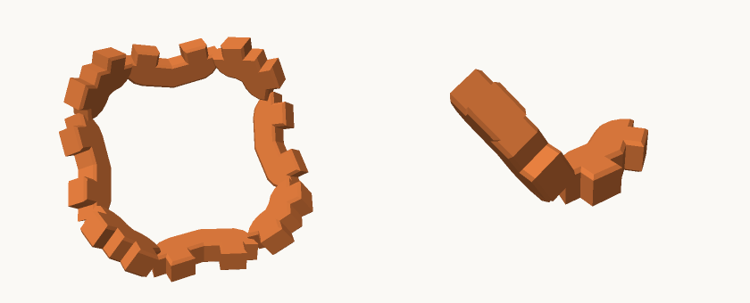
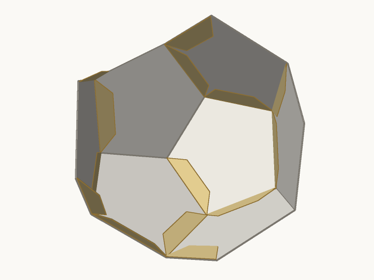
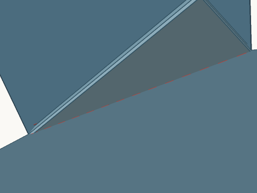
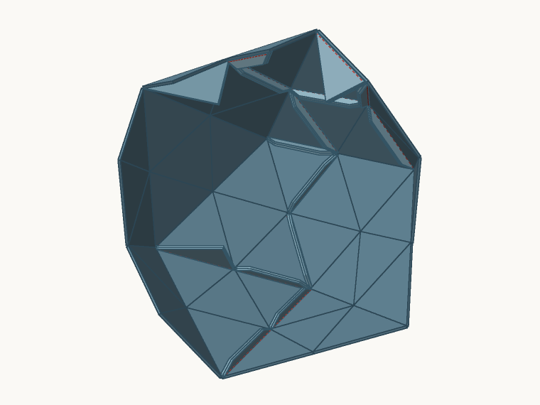
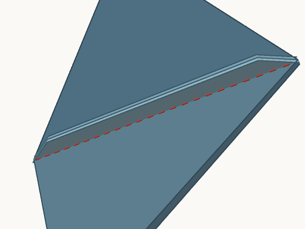

# Examples

Designs for the Cut and Fold outputs, as ordinary project files. Each carries
its job in the `production` block, so one command gives its cut files:

```bash
node scripts/shapemaker.mjs build docs/examples/fold-dodecahedron-felt-seams.shapemaker.json --out=out/felt
```

To build them all and look at them on one page, open
`test/out/examples/index.html` after running:

```bash
node scripts/build-examples.mjs
```

The tests build every one of these, so they stay current. They were rendered,
not made: nothing has been cut, folded or sewn yet.

## Cut

| | Design | Shows |
|---|---|---|
|  | [Dodecahedron, clips](cut-dodecahedron-clips.shapemaker.json) | The default join: one clip per edge, closed faces |
|  | [Open icosidodecahedron, zip ties](cut-icosidodecahedron-ties.shapemaker.json) | Ties, and openings that clear them |
|  | [Cube, finger joints](cut-cube-fingers.shapemaker.json) | The flush joint for near-90° edges, glued |
|  | [Spiked octahedron, printed corners](cut-spiked-octahedron-printed-corners.shapemaker.json) | Laser panels with 3D-printed clips, welded where they meet |

## Fold

| | Design | Shows |
|---|---|---|
|  | [Paper dodecahedron, flaps](fold-dodecahedron-paper-flaps.shapemaker.json) | Score lines and glue flaps |
|  | [Felt dodecahedron, seams](fold-dodecahedron-felt-seams.shapemaker.json) | Seams sewn from inside, with darts in the 36° notches |
|  | [Felt geodesic](fold-geodesic-felt-seams.shapemaker.json) | 80 faces in 3 nets: seams and darts |
|  | [Felt star](fold-stella-felt-cones.shapemaker.json) | Stella octangula as 8 cones, one per point, every valley a seam |

## Test cuts

These are sized to fit one small piece of stock, and they're the first thing
to make. Each answers a question the rest of the work depends on.

| Design | Stock | Procedure |
|---|---|---|
| [Paper dodecahedron](test-cuts/paper-dodecahedron-a4.shapemaker.json) | A4 paper or card | Cut the fold strip on a scrap and tune the score power: V and M should fold cleanly without cutting through, and P is a perforated line for comparison. Then cut the net. Run the engrave layer at low power, or switch it off. |
| [Plywood, clips](test-cuts/ply-dodecahedron-clips.shapemaker.json) | 2 mm plywood, 310 × 170 mm | Cut the fit strip first, and push the key into each slot. The snuggest slot that still takes it by hand is your Fit. Rebuild with `--clearance-mm=<that>/10` (for example `--clearance-mm=-0.1`) if it isn't 0, then cut the model without moving the sheet: the layout stays the same. |
| [Plywood, fingers](test-cuts/ply-octahedron-fingers.shapemaker.json) | 2 mm plywood, 310 × 170 mm | An alternative for the same piece: an octahedron with finger joints (109.5°, about 0.7 mm of play at 2 mm). Same fit-strip procedure, then glue. |
